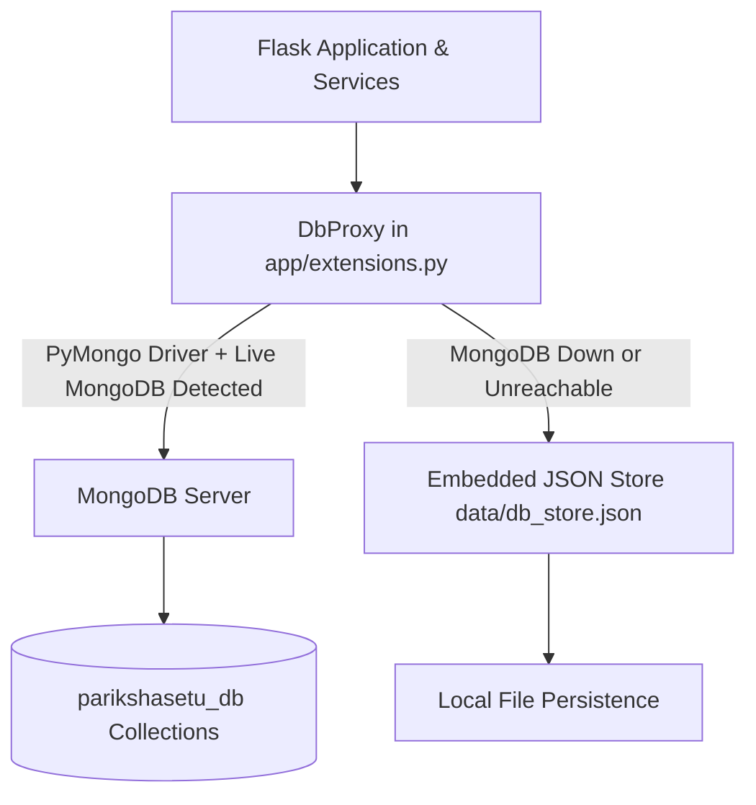

# ParikshaSetu Database Configuration & Setup Guide

This guide details the database architecture of **ParikshaSetu**, instructions for setting up MongoDB, configuring connections, initializing data, and leveraging the built-in zero-setup fallback.

---

## 🗄️ Database Architecture

ParikshaSetu features a **dual-mode persistence layer**:



### Key Collections:
1. **`users`**: User profiles, PBKDF2/SHA256 password hashes, roles (`admin` or `student`), and registration metadata.
2. **`exams`**: Supported competitive examinations (Police Bharti, MPSC, Talathi, ZP, SSC, Railway, Banking) with durations, marks, and negative marking rules.
3. **`subjects`**: Core subjects mapped to exams (specifically the 5 mandatory Police Bharti subjects) with syllabus topics, icons, and weightages.
4. **`papers`**: Previous-year question paper metadata, PDF links, district, year, and category tags.
5. **`questions`**: Question bank items with bilingual options, correct answer indices, explanations, and marks.
6. **`test_attempts`**: In-progress and completed CBT exam attempts.
7. **`results`**: Scored examination attempts with candidate answers, total scores, subject accuracy breakdowns, and AI recommendations.
8. **`api_import_logs`**: Historical audit log of JSON Mock API sync executions.

---

## 🚀 Setting Up MongoDB

### Option 1: Local MongoDB Community Server (Windows / macOS / Linux)

#### 1. Download & Install:
- Download the MongoDB Community Server MSI installer from the [MongoDB Official Download Center](https://www.mongodb.com/try/download/community).
- Complete standard installation (Install as a "Windows Service").

#### 2. Start the MongoDB Service:
- **Windows (PowerShell as Administrator)**:
  ```powershell
  net start MongoDB
  ```
- **macOS (via Homebrew)**:
  ```bash
  brew services start mongodb-community
  ```
- **Linux (systemd)**:
  ```bash
  sudo systemctl start mongod
  sudo systemctl enable mongod
  ```

#### 3. Verify Connectivity:
```powershell
python -c "import pymongo; c = pymongo.MongoClient('mongodb://localhost:27017/'); print(c.server_info()['version'])"
```

---

### Option 2: MongoDB Atlas (Cloud Managed Database)

1. Create a free M0 cluster at [MongoDB Atlas](https://www.mongodb.com/atlas).
2. Create a Database User with read/write privileges.
3. Add your IP address to the Network Access Allowlist (`0.0.0.0/0` for universal development access).
4. Obtain the SRV connection string:
   ```text
   mongodb+srv://<username>:<password>@cluster0.abcde.mongodb.net/parikshasetu_db?retryWrites=true&w=majority
   ```
5. Update your `.env` file:
   ```env
   MONGO_URI=mongodb+srv://<username>:<password>@cluster0.abcde.mongodb.net/parikshasetu_db?retryWrites=true&w=majority
   MONGO_DB_NAME=parikshasetu_db
   ```

---

### Option 3: Zero-Setup Embedded JSON Store (Automatic Fallback)

If MongoDB is not installed or the service is not currently running:
- **No manual action required.**
- The application automatically logs:
  ```text
  Using high-performance embedded Mongo-compatible JSON store (MongoDB not reachable: ...)
  ```
- All data is read from and written to `data/db_store.json`.
- Full query support is maintained (`$or`, `$in`, `$regex`, `$gte`, `$lte`, `sort`, `count_documents`, `distinct`).

---

## ⚡ Initial Data Seeding

Database seeding is **completely automated**. Upon starting the server (`python run.py`), `init_db(app)` automatically checks and populates:

1. **Default Administrator Account**:
   - Email: `admin@parikshasetu.com`
   - Password: `Admin@123`
   - Role: `admin`

2. **Default Student Account**:
   - Email: `student@parikshasetu.com`
   - Password: `Student@123`
   - Role: `student`

3. **Core Competitive Exams**:
   - Maharashtra Police Bharti
   - MPSC Group B & C Combine
   - Maharashtra Talathi Bharti (TCS Pattern)
   - Zilla Parishad (ZP) Bharti (IBPS Pattern)
   - Staff Selection Commission (SSC)
   - Railway Recruitment Board (RRB)
   - Banking Exams (IBPS / SBI / RBI)

4. **Police Bharti Mandatory 5 Subjects & Full Syllabus**:
   - मराठी व्याकरण (Marathi Grammar)
   - सामान्य ज्ञान (General Knowledge)
   - चालू घडामोडी (Current Affairs)
   - बुद्धिमत्ता चाचणी (Reasoning)
   - अंकगणित (Mathematics)

5. **Sample Papers & Question Bank**:
   - Seeded from `data/papers.json` and `app/extensions.py`.
